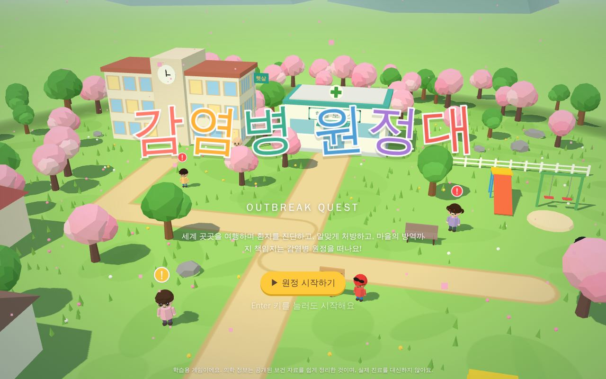
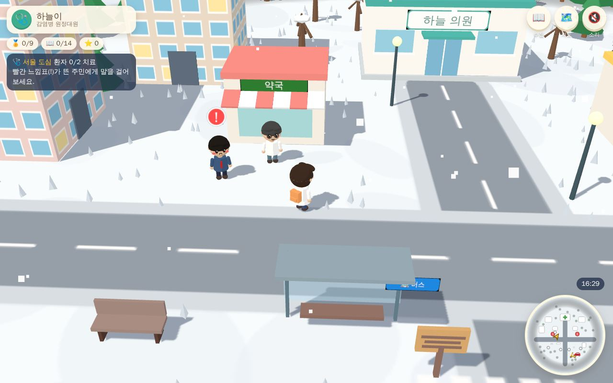
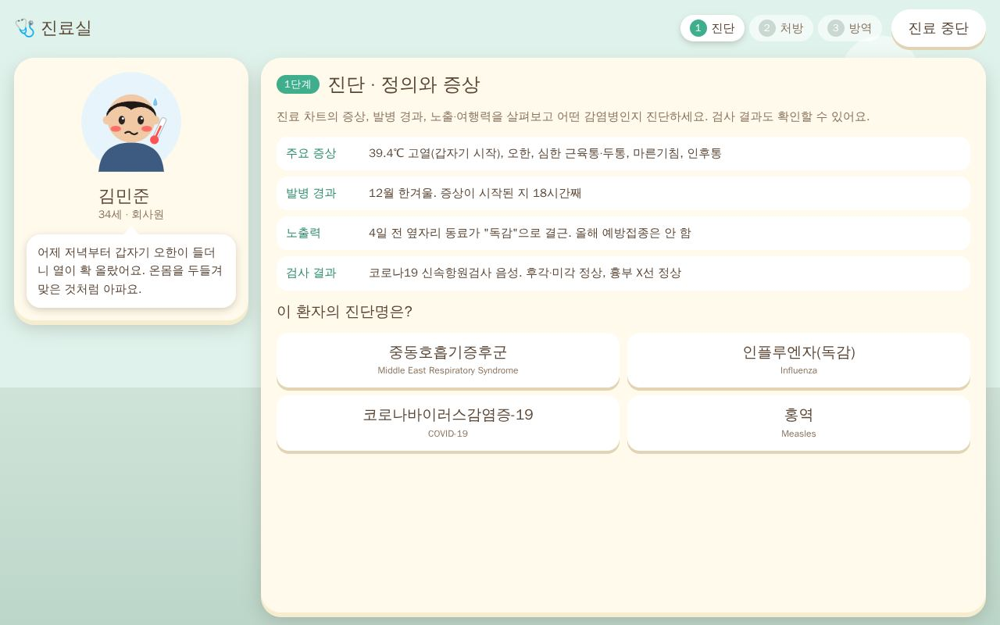
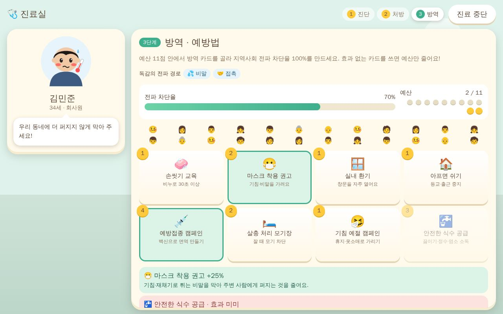
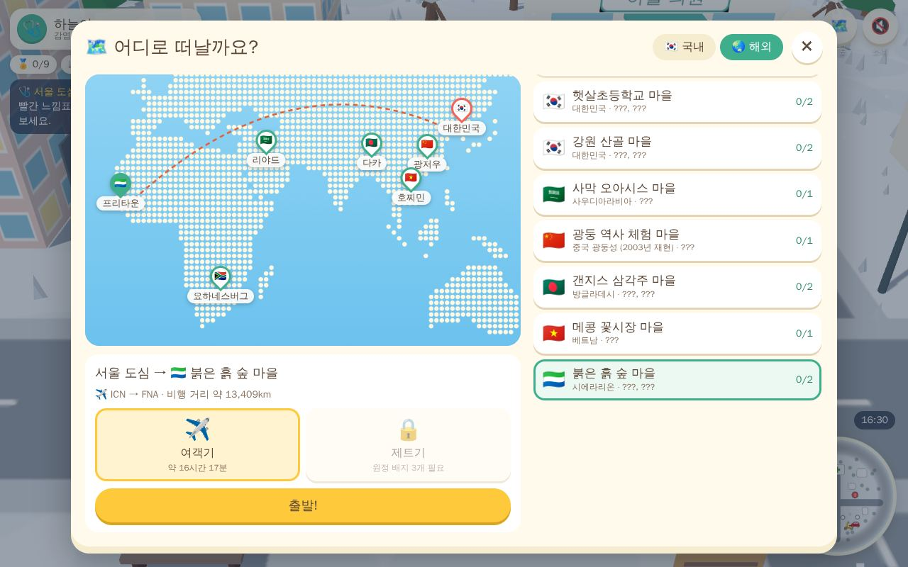

# 감염병 원정대 (Outbreak Quest)

젤다의 전설·동물의 숲처럼 마을을 돌아다니며, 지역마다 유행하는 감염병을 **진단 → 처방 → 방역** 세 단계로 배우는 3D 교육 게임입니다.
가까운 국내 지역은 바이크·자동차로, 먼 나라는 여객기·제트기로 이동해요.



| 마을 탐험 | 진료실 (1단계 진단) |
| --- | --- |
|  |  |
| **3단계 방역 카드** | **여행 지도** |
|  |  |

## 바로 실행하기

```bash
npm install
npm run dev        # 개발 서버 (http://localhost:5173)
npm run build      # dist/index.html 한 파일로 빌드
```

빌드한 `dist/index.html`은 JS·CSS가 모두 들어 있는 한 파일이라 **더블클릭만 해도** 브라우저에서 실행돼요.
GitHub Pages로 공개하려면 저장소 **Settings → Pages → Source**를 `GitHub Actions`로 바꾼 뒤, Actions 탭의 **Build & Pages** 워크플로를 `Run workflow`로 실행하세요.

## 게임 흐름 (Core Loop)

머리 위에 빨간 느낌표(❗)가 뜬 주민이 환자예요. 말을 걸면 진료실에서 3단계 진료가 시작됩니다.

1. **진단 — 정의와 증상**
   증상·발병 경과·노출력(여행력)·검사 결과 단서를 보고 4개 후보 중 정확한 감염병을 고릅니다.
   오답이면 고른 질병의 핵심 단서와 비교해 주고, 처음 만난 감염병은 정의·원인 병원체·전파 경로·잠복기·법정감염병 등급이 **도감**에 기록돼요.
2. **처방 — 치료법**
   6장의 처방 카드 중 알맞은 치료제와 간호 중재를 골라 처방전을 완성합니다.
   틀린 카드는 "바이러스 질환에는 항생제가 듣지 않아요"처럼 **왜 효과가 없는지** 설명해 줘요.
3. **방역 — 예방법**
   주어진 예산 안에서 방역 카드(음압 격리, 마스크, 예방접종, 손씻기, 안전한 식수, 모기장…)를 써서 지역사회 전파 차단율 100%를 만듭니다.
   공기 전파·수인성·모기 매개처럼 **전파 경로에 맞는 카드**를 써야 클리어할 수 있어요.

단계마다 실수 없이 풀면 별을 받아요(최대 ★3). 한 지역의 환자를 모두 치료하면 원정 배지를 받고, 배지가 모이면 자동차(1개)·제트기(3개)가 열립니다.
원정 수첩(📖)에는 질병 도감, 방문 도장을 모으는 여권, 배운 내용을 섞어 내는 복습 퀴즈, 도움말이 있어요.

## 지역과 감염병

| 지역 | 이동 | 감염병 |
| --- | --- | --- |
| 🇰🇷 서울 도심 (겨울) | 바이크·자동차 | 인플루엔자(독감), 코로나19 |
| 🇰🇷 햇살초등학교 마을 (대전, 봄) | 바이크·자동차 | 홍역, 수두 |
| 🇰🇷 강원 산골 마을 (평창) | 바이크·자동차 | 결핵, 중증열성혈소판감소증후군(SFTS) |
| 🇸🇦 사막 오아시스 마을 (리야드) | 여객기·제트기 | 중동호흡기증후군(MERS) |
| 🇨🇳 광둥 역사 체험 마을 (2003년 재현) | 여객기·제트기 | 중증급성호흡기증후군(SARS) |
| 🇧🇩 갠지스 삼각주 마을 (다카) | 여객기·제트기 | 콜레라, 장티푸스 |
| 🇻🇳 메콩 꽃시장 마을 (호찌민) | 여객기·제트기 | 뎅기열 |
| 🇸🇱 붉은 흙 숲 마을 (프리타운) | 여객기·제트기 | 말라리아, 에볼라바이러스병 |
| 🇿🇦 바오밥 언덕 마을 (요하네스버그) | 여객기·제트기 | 후천성면역결핍증(HIV/AIDS) |

## 조작법

| 키보드 | 터치 | 동작 |
| --- | --- | --- |
| WASD · 방향키 (Shift 달리기) | 화면 왼쪽 드래그 | 이동 |
| E · Space · Enter | A 버튼 | 말하기 · 살펴보기 · 타기 · 대화 넘기기 |
| Esc | 마지막 선택지 | 닫기 · 취소 |
| Tab / M | 📖 / 🗺️ 버튼 | 원정 수첩 / 여행 지도 |
| 마우스 휠 | — | 카메라 확대·축소 |

## 프로젝트 구조

```
src/
  data/diseases.js   감염병 14종: 정의·병원체·증상·진료 사례·처방 카드·방역 카드 효과
  data/cards.js      방역 카드 목록과 예산 계산
  data/regions.js    지역 9곳: 지형 테마·건물 배치·주민/환자 대사·이동수단 해금 조건
  data/geo.js        여행 지도용 대륙·한반도 윤곽
  engine/            Three.js 렌더링 (캐릭터·소품 모델, 지역 조립, 플레이어, 이동 장면)
  ui/                대화창, HUD, 진료실 3단계, 원정 수첩, 여행 지도
  main.js            게임 흐름 (타이틀 → 멘토 소개 → 진료 → 배지 → 이동)
scripts/check-data.mjs  데이터 정합성 검사 (npm run check)
```

모든 모델은 기본 도형으로 코드에서 만들고, 소리도 Web Audio로 합성해서 외부 그림·소리 파일이 없어요. 진행 상황은 브라우저 `localStorage`에 저장됩니다.

### 감염병을 추가하거나 고치려면

1. `src/data/diseases.js`에 항목을 추가합니다. `case.candidates`(진단 후보 4개, 정답 포함), `treatments`(6장, 정답 1~3장), `prevention.effective`(카드별 효과와 설명), `prevention.distractors`(효과 없는 카드와 그 이유)를 채워 주세요.
2. `src/data/regions.js`의 지역 `diseases`와 `patients`에 연결합니다.
3. `npm run check`로 후보·카드·예산이 맞물리는지 확인합니다. 예산은 가장 효율적인 카드 조합 비용에 실수 한 번을 만회할 여유를 더해 자동으로 정해져요.

## 알려 드려요

게임 속 의학 정보는 질병관리청과 세계보건기구(WHO)가 공개한 일반적인 내용을 학습용으로 쉽게 정리한 것이고, 등장인물과 사례는 학습을 위해 만든 이야기예요.
실제 진료·처방을 대신하지 않으니, 아플 때는 꼭 의료기관에서 진료를 받으세요. 감염병이 의심되면 질병관리청 콜센터(국번 없이 1339)에 문의할 수 있어요.

## 같은 저장소의 다른 게임

[`zogakzogak-puzzle/`](zogakzogak-puzzle/) 폴더에는 **조각조각 퍼즐**(zogakzogakpuzzle.com용 직소 퍼즐 웹게임)이 들어 있어요.
빌드 없이 그 폴더만 정적 호스팅에 올리면 되고, 실행·배포 방법은 [zogakzogak-puzzle/README.md](zogakzogak-puzzle/README.md)에 있어요.
